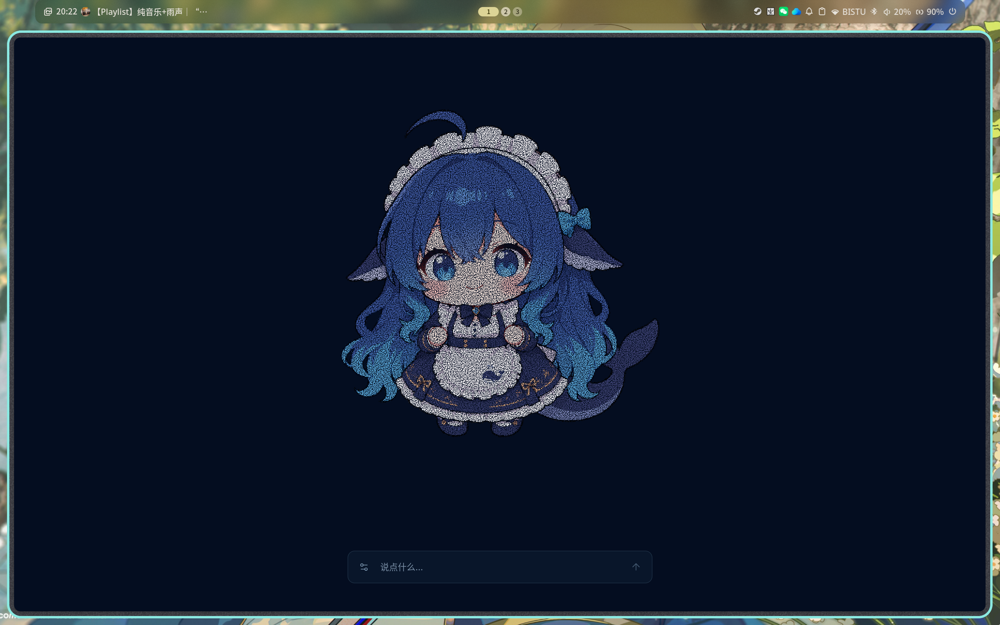

# 大肥鱼 / Lattice AI

一个有表情的 AI 聊天伙伴。Bun + React + TypeScript，前后端同源运行，无需额外启动前端服务。



- **极简主界面**：全屏暗蓝背景，只保留一个粒子表情和底部输入栏，没有 Logo、导航、介绍或聊天列表。
- **原画网格粒子**：用 `src/images/` 的 7 张透明 PNG 提取原色部件和动作轮廓，生成约 5.9 万颗粒子。主体／皮肤固定，五官通过三角形重心坐标绑定；眨眼、轻声说话与短语停顿可组合。WebGL 不可用时降级 Canvas 2D。
- **浮现回答**：默认 1–2 条短消息，最多 3 条。在表情周围随机安全位置逐条浮现，再按长度停留 6–45 秒并淡出；悬停或聚焦可暂停消失。保留当前对话上下文，但不显示传统聊天记录。
- **多模型**：DeepSeek、OpenAI、Claude、Gemini、通义千问、Kimi、硅基流动、自定义 OpenAI 兼容接口。
- **本地演示**：没有密钥也能体验，预设回复会明确标记为演示，不伪装成真实模型。
- **响应式与无障碍**：手机同屏展示表情与输入栏；键盘操作、中文输入法保护、减少动态效果、屏幕阅读器回复提示。文字淡出后，辅助阅读记录仍保留在当前页面内存。

## 启动

需要 [Bun](https://bun.sh) 1.3.14 或更新版本。

```bash
bun install
bun run dev
```

打开 **http://127.0.0.1:3000**。没有配置密钥时默认进入演示模式。

### 接入 DeepSeek（推荐服务端配置）

```bash
cp .env.example .env
```

编辑 `.env`：

```dotenv
DEEPSEEK_API_KEY=你的密钥
```

重启 `bun run dev`，点击**输入栏左侧的小设置图标**，选择「连接真实模型」。也可以在设置中临时输入密钥：**只放在当前页面内存，刷新后清除**。切换模式、服务商或模型会开始新对话。

服务端有密钥且从未保存过模式偏好时，会自动选用第一个已配置的服务商。仅填写你要使用的服务商即可，不需要全部配置。

### 服务商配置

| 服务商 | 密钥环境变量 | 示例模型 |
| --- | --- | --- |
| DeepSeek | `DEEPSEEK_API_KEY` | `deepseek-chat` / `deepseek-reasoner` |
| OpenAI | `OPENAI_API_KEY` | `gpt-4.1-mini` / `gpt-4.1` / `gpt-4o` |
| Claude | `ANTHROPIC_API_KEY` | `claude-sonnet-4-20250514` |
| Gemini | `GEMINI_API_KEY` | `gemini-2.5-flash` / `gemini-2.5-pro` |
| 通义千问 | `QWEN_API_KEY` | `qwen-plus` / `qwen-turbo` / `qwen-max` |
| Kimi | `MOONSHOT_API_KEY` | `moonshot-v1-8k` / `moonshot-v1-32k` |
| 硅基流动 | `SILICONFLOW_API_KEY` | `deepseek-ai/DeepSeek-V3` |
| 自定义 | `CUSTOM_API_KEY` | 手动填写 |

每个前缀还支持 `*_BASE_URL` 和 `*_MODEL`：前者覆盖服务端地址，后者将指定模型放到候选列表首位。模型名称可以在界面手动输入，**实际可用性、名称和计费以服务商账号为准**。地址填写到协议基础路径，不要带 `/chat/completions`、`/messages` 等具体端点。

Claude 和 Gemini 使用各自原生协议，其他服务商使用 OpenAI Chat Completions 兼容协议。推理模型只读取最终回答，不向前端传递思维链；可能比普通聊天模型慢，建议先用 `deepseek-chat`。

#### 本地 Ollama 示例

```dotenv
CUSTOM_BASE_URL=http://127.0.0.1:11434/v1
CUSTOM_API_KEY=ollama
CUSTOM_MODEL=qwen2.5:7b
```

先在 Ollama 下载并启动相应模型，再在界面选择「自定义接口」。浏览器不能随意传入上游地址，必须由 `.env` 控制。

## 图片关键帧与局部粒子

现已使用你提供的「大肥鱼」素材，不再使用公式画出的球形笑脸。保留原图的蓝发、衣服、尾巴及透明背景，白色服饰不会被当成背景去掉。

- `6_大肥鱼的温柔微笑.png`：静态闭嘴微笑基准。
- `2_…`、`3_…`、`4_…`：轻声、张嘴、圆嘴的说话口型。
- `5_忧伤的大肥鱼.png`：低落时的眼睛、眉毛、嘴部。
- `1_大肥鱼全身像.png`、`7_大肥鱼眨眼.png`：开心嘴型、闭眼／眨眼。

本轮先完成**眨眼和轻声说话**。不再使用矩形区域重匹配、统一唇色、程序补画的下眼线或整块渐隐。眼睑、眉毛、上下唇保留原画笔触，边缘做原色去底污染处理；粒子提取后 RGBA 固定，只随绑定网格移动。

眼球保持原位置，由变形后的原画 alpha 开口遮挡；嘴内与上下唇共用口型轮廓，闭嘴时开口面积归零。口腔以轻声原画采样，避免把大张嘴的密集点阵压成一块不同粒度的贴片。短语／标点驱动动作，不按每个字机械张嘴；停止后收口，自然眨眼独立运行。暂不叠加视线漂移或独立舌头动作。

**校对入口：[http://127.0.0.1:3000/preview/character](http://127.0.0.1:3000/preview/character)**。可以查看补底图、原色联动和粒子联动，放大五官、拖动进度，并打开原始参考与透明部件图集。此页面独立于极简主界面，不增加主屏导航。请先看分层和中间帧，再判断粒子效果；通过测试不等于画风已通过人工验收。

运行项目**不需要 Python**，已包含约 2.3 MiB 的粒子／网格数据，以及只供校对页加载的补底图。修改图片或控制点后才需要重新生成（Python 3 + Pillow）：

```bash
# 如本机尚未安装 Pillow，先创建并激活虚拟环境：
python3 -m venv .venv
source .venv/bin/activate
python3 -m pip install -r scripts/requirements.txt
bun run assets:character
bun run assets:character --check
bun run assets:character --preview-dir /tmp/character-preview
```

**`src/images/character.json`** 配置分析范围、原画不规则蒙版引导、发际线保护、眼部与眉毛控制。生成链路为 `native_layers.py` → `mesh_binding.py` → `build-character.py`，输出到 `src/client/particles/generated/`。主界面仅请求编译后的数据，不下载七张 PNG 播放；校对页才加载原色图片。`--check` 同时验证二进制、来源清单与两张校对 PNG。

原图没有 PSD 分层，被五官遮住的背景只能估计补底，不能声称恢复了不可见的原画。补底使用同一基准图的肤色／头发延展与局部边缘克隆，不借用未对齐的其他表情皮肤；发际线等细节仍需在校对页人工复核。替换角色需要重新校准，而非任意图片通用绑定。

这是二维网格／粒子动画，**不是自动三维重建，也不是音频音素对口型**。更多实现细节见 [`docs/image-particles.md`](docs/image-particles.md)。

## 回答规范与表情协议

独立提示词位于 **[`prompts/companion.md`](prompts/companion.md)**，修改后重启服务即可生效。

默认自然聊天、先回应重点、每条约 10–45 字、一次最多一个追问；用户明确要求完整代码或长教程时可以适当放宽。模型必须返回：

```json
{"emotion":"happy","messages":["嗨，我是点点。","想聊点什么？"]}
```

表情：`neutral`、`happy`、`excited`、`curious`、`thinking`、`sympathetic`、`surprised`。

服务端增量解析完整字符串，再通过 SSE 向浏览器发送表情和消息；不会把 JSON 协议文本直接显示到页面。粒子嘴型跟随**文字显示状态**，不是语音识别或音频口型同步。当前未实现语音输入／朗读。

浮现文字会避开表情与输入栏，长内容可聚焦后滚动阅读。第三条消息出现时，最早的一条提前淡出，避免主界面堆积。停止／重试仅在需要时出现；清空当前对话的入口放在模型设置中。

## API

### `GET /api/providers`

返回服务商、候选模型和 `configured` 状态，**不返回密钥和私有接口地址**。

### `POST /api/chat`

```bash
curl -N http://127.0.0.1:3000/api/chat \
  -H 'Content-Type: application/json' \
  -d '{"provider":"deepseek","model":"deepseek-chat","messages":[{"role":"user","content":"你好"}]}'
```

默认使用服务端密钥。可选 `apiKey` 字段仅覆盖本次请求的密钥。聊天记录只接受 `user` / `assistant` 交替发言，系统提示词由服务端管理。

SSE 事件示例：

```text
data: {"type":"emotion","emotion":"happy"}

data: {"type":"message","text":"嗨，很高兴见到你。","index":0}

data: {"type":"done"}
```

请求校验错误返回 JSON `{ "error": "说明" }` 和 HTTP 错误码；开始流式响应后，生成错误返回 `{ "type": "error", "message": "说明" }` 事件。90 秒超时；停止回复会取消正在进行的上游请求，但已经消耗的 token 仍可能计费。

## 隐私与部署

- 密钥不打包进前端，不写入浏览器持久存储，不记录请求正文；`.env*` 默认忽略，保留 `.env.example`。
- 聊天仅保存在当前页面内存，刷新即清空；仅保存服务商、模型名和模式偏好。真实模式会把最近完整对话发送给所选服务商，请勿输入敏感信息。
- 前端不依赖外部字体、图片或 CDN；本地演示不请求外部 AI 服务。
- 默认仅监听 `127.0.0.1`，限制请求体大小、消息格式和并发，并检查 Origin／Host。**这些不是身份认证，当前版本是个人本地应用。**
- 如需局域网访问，可设 `HOST=0.0.0.0`，并将 `APP_ORIGIN` 设为实际访问地址，例如 `http://192.168.1.10:3000`。修改 `.env` 后重启。
- 公网部署前必须增加认证、用户级限流、调用配额和 HTTPS，否则其他人可能消耗你的模型额度。反向代理应关闭 SSE 缓冲，并把 `APP_ORIGIN` 设为浏览器中的站点源。

生产模式直接运行，Bun 自动打包 HTML/CSS/TSX：

```bash
bun run start
```

## 验证

```bash
bun run typecheck
bun run test
bunx playwright install chromium  # 首次运行浏览器测试时
bun run test:e2e
```

单元测试覆盖三种协议、网络分片、JSON 回复、安全校验、来源哈希、重心绑定源坐标重建、RGBA／静态主体不变、网格不翻折、开口闭合、上下唇联动、口腔粒度与短语调度。浏览器测试读取真实渲染像素，检查 25%／50%／75% 中间帧的保护区，以及原色校对、实际说话像素变化、主屏不加载表情 PNG、降级、减少动态效果、聊天流程、响应式和 axe 规则。**这些是技术回归，不代替原画风格与动作自然度的人工验收。**

测试使用本地模拟上游，**不代表已用付费密钥验证各服务商的当前在线可用性**。真实接入需要你自己的 API Key。

## 目录

```text
index.ts                       Bun 服务入口
prompts/companion.md            回答规范 / 系统提示词
src/server/providers.ts        服务商协议适配与 SSE 读取
src/server/reply.ts            流式 JSON 回复解码
src/server/app.ts              API 校验、安全边界、超时与取消
src/shared/types.ts            前后端协议与表情定义
src/client/components/         粒子场景、浮现文字、输入栏、设置
src/images/                    原始关键帧 PNG、区域与控制点配置
scripts/native_layers.py       原画蒙版、分材质补底与边缘提取（Pillow）
scripts/mesh_binding.py        局部网格、重心绑定与图集打包
scripts/build-character.py     确定性编译与来源／校对资源哈希
src/client/particles/          动作库、网格粒子、WebGL 与 Canvas 降级
src/client/review/             补底／原色／粒子逐帧校对页面
src/client/particles/generated/ 粒子网格二进制、来源清单与校对 PNG
src/client/hooks/              对话状态、视口测量与弹窗焦点管理
src/client/lib/                SSE 客户端、上下文裁剪、演示回复、随机布局
tests/unit/                    Bun 单元测试
tests/e2e/                     Playwright + axe 浏览器测试
```
